**English** | [简体中文](README.md)

<picture>
  <source media="(max-width: 640px) and (prefers-color-scheme: dark)" srcset="assets/presentation/hero-mobile-dark.svg">
  <source media="(max-width: 640px)" srcset="assets/presentation/hero-mobile-light.svg">
  <source media="(prefers-color-scheme: dark)" srcset="assets/presentation/hero-dark.svg">
  
</picture>

**Organize repository files within a token budget, track content changes and expose project context through CLI or MCP.**

`v0.8.0` · `Python 3.12+` · [MIT](LICENSE)

[Website](https://ctxfeed.lei6393.com) · [Demo record](docs/demo-results.json)

## Why use it

Before sending many files to a model, inspect which files fit, their ordering and what changed since the last plan. ctxfeed represents those choices in a ShardPlan containing a stable prefix, repository body and change set.

## Architecture

<picture>
  <source media="(max-width: 640px) and (prefers-color-scheme: dark)" srcset="assets/presentation/architecture-mobile-dark.svg">
  <source media="(max-width: 640px)" srcset="assets/presentation/architecture-mobile-light.svg">
  <source media="(prefers-color-scheme: dark)" srcset="assets/presentation/architecture-dark.svg">
  
</picture>

ingest scans and counts files; shard builds a budgeted, ordered plan. CachePlan stores file hashes in repository-scoped SQLite. CLI and MCP share this path, and model adapters send assembled context on queries. The delta is local bookkeeping: it does not mean only changed content is transmitted or measure provider prefix-cache behavior.

Source entry points: [src/ctxfeed/cli.py](src/ctxfeed/cli.py) · [src/ctxfeed/cache_plan.py](src/ctxfeed/cache_plan.py) · [src/ctxfeed/ingest.py](src/ctxfeed/ingest.py) · [src/ctxfeed/shard.py](src/ctxfeed/shard.py) · [src/ctxfeed/mcp_server.py](src/ctxfeed/mcp_server.py) · [src/ctxfeed/models/glm.py](src/ctxfeed/models/glm.py) · [src/ctxfeed/models/deepseek.py](src/ctxfeed/models/deepseek.py)

## Install

Requires Python 3.12+ and uv. The example only builds local plans and needs no API key; first tokenizer use may populate encoding-file caches.

```bash
git clone https://github.com/SuperMarioYL/ctxfeed.git
cd ctxfeed
uv venv --python 3.12
uv pip install --python .venv/bin/python -e .
```

## Quickstart

The complete script creates two temporary files and builds three plans. cached_fraction is the fraction of locally known file hashes, not model-cache telemetry or measured billing.

```bash
.venv/bin/python examples/presentation-demo.py
```

Complete inputs and execution steps are included in the commands above and the [demo record](docs/demo-results.json).

## Usage

```bash
.venv/bin/ctxfeed init --repo .
.venv/bin/ctxfeed add ./src/ctxfeed/cli.py
.venv/bin/ctxfeed cost --repo .
.venv/bin/ctxfeed mcp --repo .
```
init uses dry-run when the selected model has no key; setting a key can enable service calls. In an MCP client, set command to the absolute path of this clone’s `.venv/bin/ctxfeed` and args to `["mcp", "--repo", "/absolute/repo"]`.

## Recorded demo

<picture>
  <source media="(max-width: 640px) and (prefers-color-scheme: dark)" srcset="assets/presentation/process-mobile-dark.svg">
  <source media="(max-width: 640px)" srcset="assets/presentation/process-mobile-light.svg">
  <source media="(prefers-color-scheme: dark)" srcset="assets/presentation/process-dark.svg">
  
</picture>

### Inspect three plans

The first, unchanged and edited plans contain 2, 0 and 1 changed hashes.

```text
$ .venv/bin/python examples/presentation-demo.py
[
  {
    "stage": "first",
    "files": 2,
    "delta_hashes": 2,
    "cached_fraction": 0.0,
    "stable_prefix": [
      "README.md"
    ]
  },
  {
    "stage": "unchanged",
    "files": 2,
    "delta_hashes": 0,
    "cached_fraction": 1.0,
    "stable_prefix": [
      "README.md"
    ]
  },
  {
    "stage": "edited",
    "files": 2,
    "delta_hashes": 1,
    "cached_fraction": 0.5,
    "stable_prefix": [
      "README.md"
    ]
  }
]
```

## Capabilities and integration

<picture>
  <source media="(max-width: 640px) and (prefers-color-scheme: dark)" srcset="assets/presentation/integrations-mobile-dark.svg">
  <source media="(max-width: 640px)" srcset="assets/presentation/integrations-mobile-light.svg">
  <source media="(prefers-color-scheme: dark)" srcset="assets/presentation/integrations-dark.svg">
  
</picture>

The CLI exposes init, add, cost and mcp. MCP list_files shows files and cache markers, query_repo submits a question and cost_delta estimates from repository-defined rates. GLM and DeepSeek are selectable adapters, not automatic runtime failover.


## Configuration

`--model` overrides `CTXFEED_MODEL`; values are glm or deepseek. GLM reads `ZHIPU_API_KEY`/`GLM_API_KEY`; DeepSeek reads `DEEPSEEK_API_KEY`. IngestConfig owns window, headroom, max_file_bytes and cache_db, defaulting to `.ctxfeed/cache.db`. Adapter model names, windows and rates are configuration assumptions to check against the actual account.

## Roadmap and scope

Budgeted plans, change bookkeeping, two adapters and MCP are implemented. Further work should use real repository-QA results, provider cache telemetry and verified provider configuration.

- Files can be skipped due to ignore rules, size or budget; arbitrary repositories are not guaranteed to fit.
- Dry-run answers are built-in simulations and cost is a static estimate; this example calls no model.

 · [Recording script](docs/demo.tape)

## License

[MIT](LICENSE)
